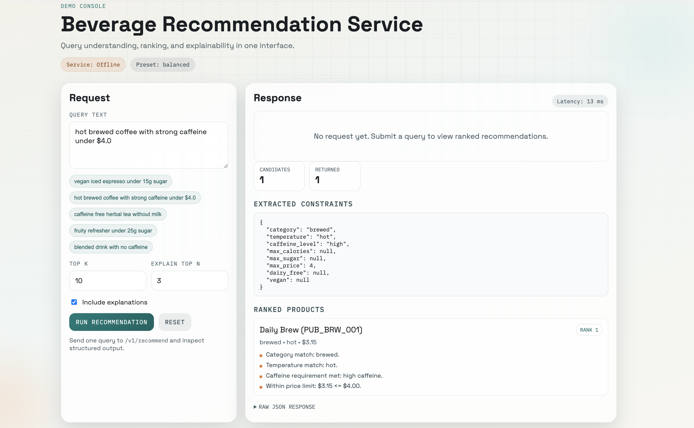

# Beverage Recommendation Platform


Production-style recommendation platform for mapping natural-language beverage requests to ranked product IDs, with explainability, automated experiment management, and online API serving.

## Core Capabilities

- Query constraint extraction (LLM mode or offline parser)
- Constraint-aware candidate filtering with fallback relaxation
- Hybrid ranking (semantic/lexical relevance + constraint score)
- Explainable recommendation reasons and per-item constraint score
- Automated experiment suite execution and artifact archiving
- FastAPI online service with batch endpoint
- Built-in frontend demo served by backend

## Data Privacy and Sanitization

This repository is prepared for public sharing.

- `data/` contains synthetic, de-identified sample CSV files
- Real/private datasets are excluded from version control
- Generated artifacts (`outputs/`, `cache/`) are excluded from version control
- Local secret-scan reports (`gitleaks-*.json`) are excluded from version control

Scope details: [PUBLIC_RELEASE.md](PUBLIC_RELEASE.md)

## Architecture Overview

Runtime flow:

1. Query understanding: `src/core/constraint_extraction.py`
2. Candidate filtering: `src/core/product_filtering.py`
3. Ranking: `src/core/embedding_ranking.py`
4. Explainability: `src/core/explainability.py`
5. Service orchestration: `src/core/recommendation_engine.py`
6. Delivery layer: `src/cli/*` and `src/app/api.py`

## Quick Start

### Install

```bash
git clone <your-repo-url>
cd <project-directory>
pip install -r requirements.txt
```

### Offline baseline (no API key required)

```bash
MODEL_PRESET=offline python -m src.cli.evaluate
MODEL_PRESET=offline python -m src.cli.generate_submission
```

### Explainable output

```bash
MODEL_PRESET=offline WRITE_EXPLANATIONS=true python -m src.cli.generate_submission
```

Outputs:

- `outputs/submission.csv`
- `outputs/recommendation_explanations.json`

### Online mode (OpenAI-compatible)

```bash
export OPENAI_API_KEY="your-api-key"
MODEL_PRESET=balanced python -m src.cli.evaluate
MODEL_PRESET=balanced python -m src.cli.generate_submission
```

## Automated Experiment Management

Run default suite:

```bash
python -m src.cli.experiments --config src/cli/suites/default.json
```

Run artifacts are saved to:

- `outputs/experiments/<suite>_<timestamp>/results.json`
- `outputs/experiments/<suite>_<timestamp>/results.csv`
- `outputs/experiments/<suite>_<timestamp>/summary.md`
- `outputs/experiments/<suite>_<timestamp>/logs/*.log`

## Online Service (FastAPI)

Start service:

```bash
python -m uvicorn src.app.api:app --host 0.0.0.0 --port 8000 --reload
```

API endpoints:

- `GET /health`
- `GET /v1/config`
- `POST /v1/recommend`
- `POST /v1/recommend/batch`
- `GET /demo/`

Example request:

```bash
curl -X POST http://localhost:8000/v1/recommend \
  -H "Content-Type: application/json" \
  -d '{
    "query_text": "vegan iced espresso under 15g sugar",
    "top_k": 5,
    "include_explanations": true,
    "explanation_top_n": 3
  }'
```

## Frontend Demo

The backend serves an interactive demo page at:

```text
http://localhost:8000/demo/
```

Preview:



The demo supports query input, quick query chips, top-k controls, explanation toggles, ranked cards, extracted constraints, and raw JSON inspection.

## Model Profiles

| Preset | Extraction | Expansion | Embeddings | Query Expansion | Typical Usage |
|---|---|---|---|---|---|
| `offline` | local parser | local rewrites | lexical mode | No | local dev, CI |
| `fast` | `gpt-4o-mini` | `gpt-4o-mini` | `text-embedding-3-small` | No | speed/cost |
| `balanced` | `gpt-4o-mini` | `gpt-4o-mini` | `text-embedding-3-large` | Yes | default online |
| `quality` | `gpt-4o` | `gpt-4o` | `text-embedding-3-large` | Yes | quality-first runs |

Optional overrides:

```bash
export EXTRACTION_MODEL="gpt-4o"
export EXPANSION_MODEL="gpt-4o-mini"
export EMBEDDING_MODEL="text-embedding-3-large"
export USE_QUERY_EXPANSION="true"
export OPENAI_BASE_URL="https://your-compatible-endpoint/v1"
```

## Configuration Reference

| Variable | Purpose | Default |
|---|---|---|
| `MODEL_PRESET` | runtime model profile | `balanced` |
| `OPENAI_API_KEY` | enable online mode | unset |
| `OPENAI_BASE_URL` | OpenAI-compatible endpoint | unset |
| `FORCE_OFFLINE_MODE` | force local mode | `false` |
| `PRODUCTS_CSV` | product catalog path | auto-resolved |
| `QUERIES_TRAIN_CSV` | training query path | auto-resolved |
| `QUERIES_TEST_CSV` | test query path | auto-resolved |
| `SUBMISSION_CSV` | submission output path | `outputs/submission.csv` |
| `WRITE_EXPLANATIONS` | explanation output toggle | `false` |
| `EXPLANATION_TOP_N` | explanation item count | `5` |

## Testing and Quality Gates

Run full local check:

```bash
python -m compileall -q src
python -m unittest discover -s tests -v
```

CI (`.github/workflows/ci.yml`) validates:

- syntax compilation
- unit tests
- offline evaluation smoke test
- offline submission smoke test
- offline experiments smoke test

## Make Targets

```bash
make check
make eval-offline
make submit-offline
make explain-offline
make experiments
make api
```

## Repository Layout

```text
project_root/
├── .github/workflows/ci.yml
├── data/
│   ├── sample_products.csv
│   ├── sample_queries_train.csv
│   ├── sample_queries_test.csv
│   ├── sample_submission.csv
│   └── README.md
├── src/
│   ├── app/
│   │   ├── api.py
│   │   └── demo/
│   │       ├── index.html
│   │       ├── styles.css
│   │       ├── app.js
│   │       └── demo-screenshot.png
│   ├── cli/
│   │   ├── evaluate.py
│   │   ├── generate_submission.py
│   │   ├── experiments.py
│   │   └── suites/default.json
│   ├── core/
│   │   ├── constraint_extraction.py
│   │   ├── product_filtering.py
│   │   ├── embedding_ranking.py
│   │   ├── explainability.py
│   │   └── recommendation_engine.py
│   ├── config.py
│   └── openai_client.py
├── tests/
├── PUBLIC_RELEASE.md
├── Makefile
├── requirements.txt
└── README.md
```
